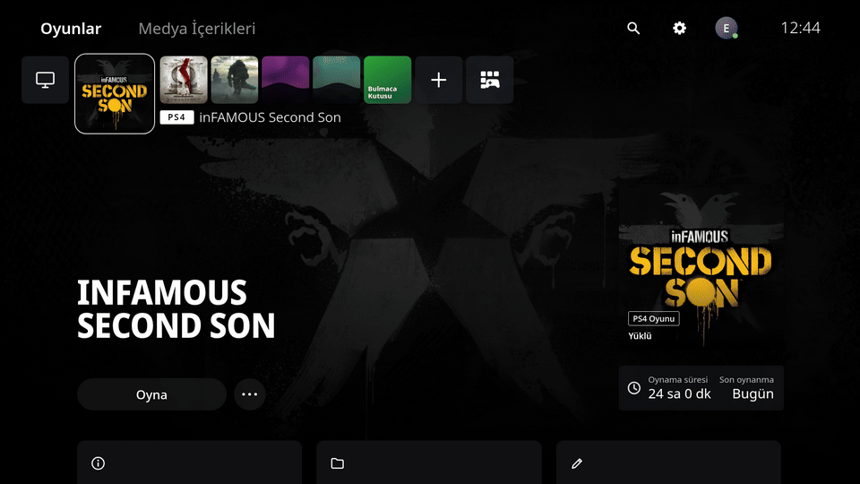
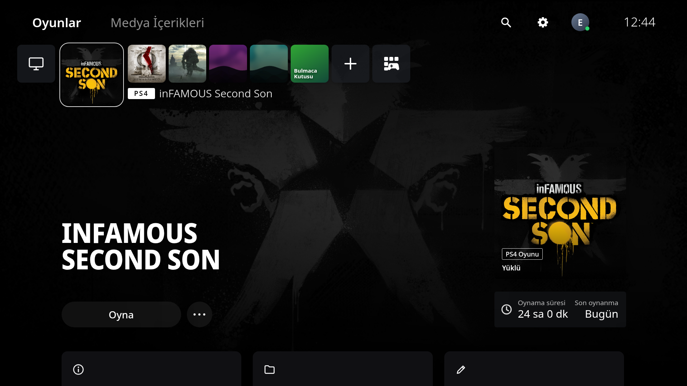
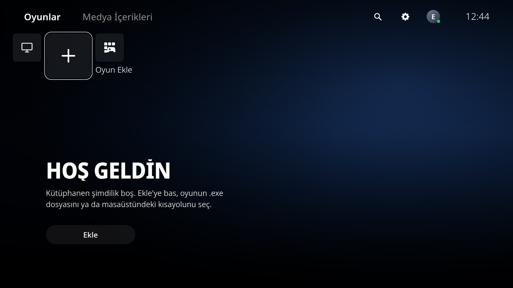
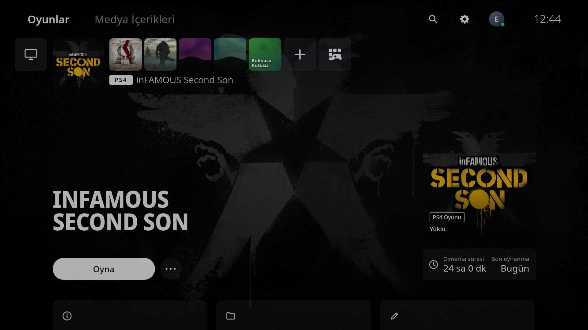
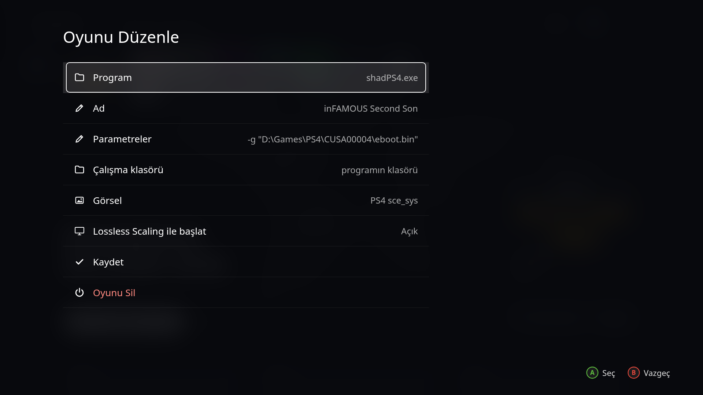
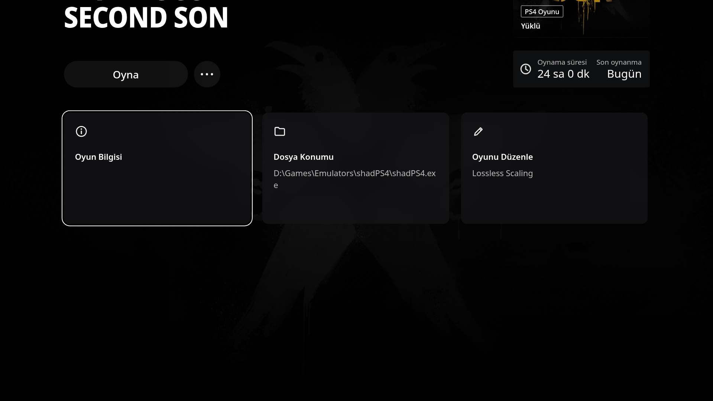
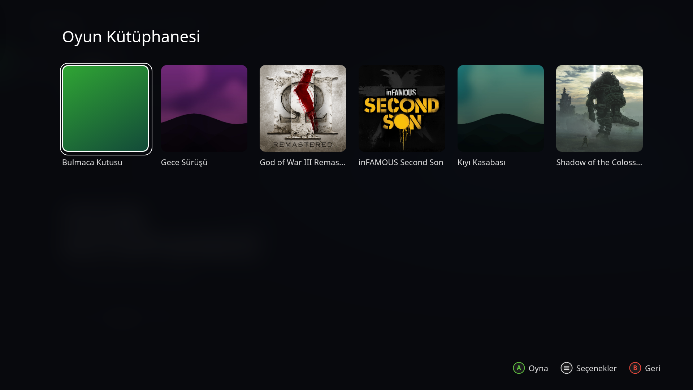
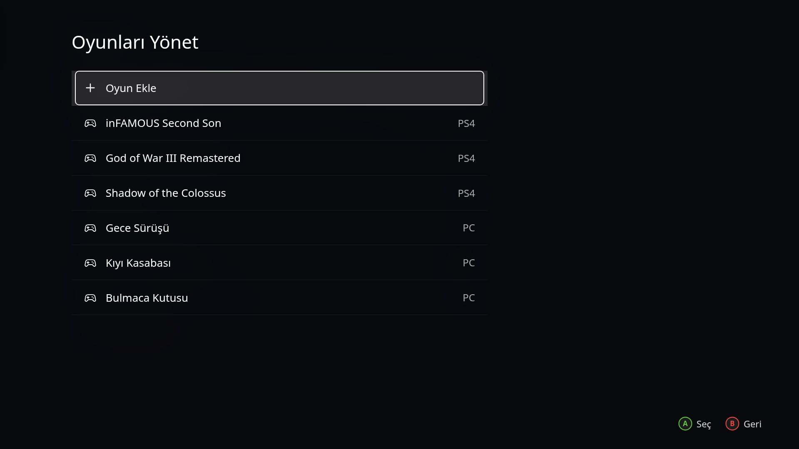
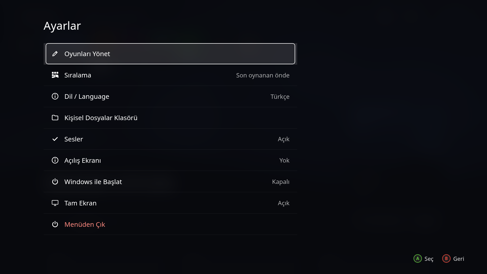

<div align="center">


# Definitely Not PS5 Menu

*Kesinlikle bir PS5 menüsü değil. Sadece biraz ona benziyor, o kadar.*

[](https://github.com/kutaykilicai/definitely-not-ps5-menu/releases/latest)
[](https://github.com/kutaykilicai/definitely-not-ps5-menu/releases)
[](LICENSE)
[](#kurulum)



</div>

## Nedir

Windows için yazılmış, PS5 ana ekranına benzeyen bir oyun başlatıcı. Bilgisayarındaki oyunları, emülatörleri ve kısayolları büyük kapaklarıyla tek bir ekranda toplar. Kanepeden kumandayla da masa başında klavyeyle de rahat kullanılsın diye yapıldı. Bir oyunu başlattığında yükleme ekranı oyun penceresi hazır olana kadar kalır, sonra menü tamamen kapanır ve oyunun önünde ya da arkasında hiçbir penceresi kalmaz. Oyun kapanınca menü ana ekranda, o oyun seçili hâlde geri gelir.

Resmi bir ürün değil, hayran işi bir projedir. Sony ile hiçbir bağı yoktur.



## Özellikler

- Oyun ekleme, düzenleme, sıralama ve silme uygulamanın içinden yapılır, dosya düzenlemen gerekmez.
- PS4 dökümlerinin `sce_sys` klasöründen kapak, arka plan ve oyun adı alınır; görseli olmayan oyunlara programın simgesiyle bir kutucuk hazırlanır.
- Xbox kumandası ve klavye desteği, oyun sırasında Ctrl+Alt+Home ile menüye dönüş.
- İstersen oyun Lossless Scaling ile birlikte açılır ve ölçekleme kendiliğinden başlar.
- Tek tıkla kurulum, yönetici izni istemez.

## Kurulum

[Releases](https://github.com/kutaykilicai/definitely-not-ps5-menu/releases/latest) sayfasından `Definitely.Not.PS5.Menu.Setup.1.2.1.exe` dosyasını indirip çalıştır. Kurulum birkaç saniye sürer, yönetici izni istemez, masaüstüne ve Başlat menüsüne kısayol koyar ve bitince menüyü açar.

Uygulama imzalı olmadığı için Windows ilk açılışta "Windows bilgisayarınızı korudu" uyarısı gösterebilir. O pencerede **Diğer bilgiler** yazısına, ardından **Yine de çalıştır** düğmesine bas. Bunu yalnızca bir kez yapman gerekir.

Kurmadan denemek istersen aynı sayfadaki `Definitely-Not-PS5-Menu-1.2.1-portable.zip` dosyasını bir klasöre çıkarıp içindeki `Definitely Not PS5 Menu.exe` dosyasını açabilirsin.

<table>
<tr>
<td width="50%"><br><sub>İlk açılışta kütüphane boştur, imleç Oyun Ekle kutucuğunda bekler.</sub></td>
<td width="50%"><br><sub>Oyun açılırken menü, oyunun görseliyle karanlığa geçer.</sub></td>
</tr>
</table>

## Oyun ekleme

1. Ana ekrandaki **+** kutucuğuna bas. Dosya seçme penceresi açılır.
2. Oyunun `.exe` dosyasını ya da masaüstündeki kısayolunu seç. Kısayol seçersen içindeki parametreler ve çalışma klasörü de olduğu gibi gelir. Emülatörle açılan bir oyunsa emülatörün exe'sini seçip oyunu açan komutu **Parametreler** satırına yaz, örneğin shadPS4 için `-g "D:\Games\PS4\CUSA00000\eboot.bin"`.
3. **Görsel** satırından bir kapak resmi seç ya da PS4 dökümünün `sce_sys` klasörünü göster, sonra **Kaydet**'e bas.



Sonradan değiştirmek istediğinde oyunun seçeneklerinden **Oyunu Düzenle**'yi aç. Tüm liste Ayarlar'daki **Oyunları Yönet** bölümünde durur; buradan sırayı değiştirebilir ya da bir oyunu silebilirsin. Silmek oyunu yalnızca listeden çıkarır, dosyalarına dokunmaz. Ad ve parametre gibi yazı gereken alanlarda klavye lazım olur, ama kumandayla eklerken bile ad exe'den, kısayoldan ya da `sce_sys` klasöründen kendiliğinden dolar.

<table>
<tr>
<td width="50%"><br><sub>Aşağı inince oyunun bilgileri, dosya konumu ve düzenleme kartı.</sub></td>
<td width="50%"><br><sub>Kütüphane bütün oyunları alfabetik olarak gösterir.</sub></td>
</tr>
<tr>
<td width="50%"><br><sub>Oyunları Yönet: ekleme, düzenleme, sıralama, silme.</sub></td>
<td width="50%"><br><sub>Ayarlar ekranı.</sub></td>
</tr>
</table>

## Kontroller

| | Xbox kumandası | Klavye |
|---|---|---|
| Gezinme | Sol çubuk ya da yön tuşları | Ok tuşları |
| Seç / Oyna | A | Enter |
| Geri | B | Esc |
| Oyun seçenekleri | Menü (≡) | O |
| Oyunlar / Medya sekmesi | LB, RB | Q, E |
| Ana ekrana dön | Xbox düğmesi ya da Görünüm + Menü | H |
| Oyun açıkken menüye dön | | Ctrl+Alt+Home |
| Menüden çık | | Alt+F4 |

Oyun açıkken Ctrl+Alt+Home'a basınca oyun kapanmaz, arkada çalışmaya devam eder. Menüde **Oyuna Dön**'e basınca kaldığın yere geçersin.

## Lossless Scaling

Steam'den [Lossless Scaling](https://store.steampowered.com/app/993090/Lossless_Scaling/) kuruluysa menü onu kendisi bulur ve oyun düzenleme ekranında **Lossless Scaling ile başlat** seçeneği görünür. Açtığında LS'e o oyuna ait bir profil eklenir (Auto Scale açık, beş saniye gecikmeli). Oyunu başlattığında LS yükleme ekranının arkasında simge durumunda açılır, penceresi öne çıkarsa menü onu geri indirir. Oyun açıldıktan sonra odak oyunda tutulur, böylece kumanda oyunu kullanmaya devam eder ve ölçekleme birkaç saniye içinde kendiliğinden başlar. Auto Scale bir sebeple devreye girmezse menü, oyun ön planda ve tam ekranken ve ortada hiçbir LS penceresi yokken LS'in ölçekleme kısayoluna bir kez basar, ardından odağı oyuna geri verir. Profil eklenmeden önce LS'in ayar dosyası yedeklenir; LS o sırada açıksa profil eklenmez; LS kapalıyken oyunu başlattığında menü onu kendisi ekler. LS kurulu değilse seçeneğin yerine kısa bir not çıkar.

LS, tam ekran özel (exclusive fullscreen) modda çalışan oyunları ölçekleyemez. Bu yüzden oyunu pencereli ya da kenarlıksız tam ekran moduna alman gerekir.

## Kaldırma

Windows Ayarlar > Uygulamalar > Yüklü uygulamalar listesinde **Definitely Not PS5 Menu** satırını bulup Kaldır'a bas. Oyun listen ve ayarların `%APPDATA%\Definitely Not PS5 Menu` klasöründe kalır, yeniden kurarsan her şey olduğu gibi geri gelir. Hiç iz kalmasın istiyorsan o klasörü de sil.

## SSS

**Oyunlarım nerede saklanıyor?**
Liste, ayarlar ve seçtiğin görseller `%APPDATA%\Definitely Not PS5 Menu` klasöründe durur. Eski "PS5 Menu" sürümünü kullandıysan oyunların ilk açılışta oraya kendiliğinden taşınır.

**Windows açılınca kendiliğinden başlasın istiyorum.**
Ayarlar'daki **Windows ile Başlat** satırını aç.

**Bir oyun başlıyor ama menü hemen geri geliyor.**
Bazı oyunlar önce kısa ömürlü bir başlatıcı açar. Menü normalde asıl oyunun penceresini bekler; yine de olmuyorsa oyunun kendi exe'sini seçmeyi dene.

**Oyun kapağı bulanık ya da yok.**
Görsel satırından kare bir kapak (en az 512x512) ve 16:9 bir arka plan seçebilirsin.

**Kumandam çalışmıyor.**
Menü, Windows'un Xbox kumandası desteğini kullanır. Kumanda başka bir oyunda çalışıyorsa menüde de çalışır; Steam açıksa Steam Input'un kumandayı yakalamadığından emin ol.

## Geliştirme

Uygulama Electron ile yazıldı. Oyun pencerelerini izleyen küçük yardımcı program `native/ps5winhelper.c` içinde, mingw ile derlenir. Testler `node test/unit.test.js` ve `node test/winwatch.test.js` ile çalışır, kurulum dosyaları `node tools/build.js` ile `dist/` klasörüne çıkar.

```
cd app && npm install && npx electron . --windowed
```

## Lisans ve uyarı

Kod MIT lisansıyla dağıtılır, ayrıntılar [LICENSE](LICENSE) dosyasında. Yazı tipi Noto Sans, SIL Open Font License ile gelir.

Bu proje resmi değildir; Sony Interactive Entertainment ile bağlantısı yoktur, onlar tarafından desteklenmez ya da onaylanmaz. PlayStation ve PS5, Sony Interactive Entertainment Inc.'in ticari markalarıdır. Uygulamada Sony'ye ait kod, yazı tipi, ses ya da görsel bulunmaz; arayüzdeki her şey sıfırdan çizildi. Ekran görüntülerinde görünen oyun kapakları sahiplerine aittir ve yalnızca menünün nasıl göründüğünü göstermek için kullanıldı, depoda ya da kurulum dosyasında yer almaz.

## English

*Definitely not a PS5 menu. It just looks a bit like one.*

A game launcher for Windows that looks like the PS5 home screen. You add games, emulators or shortcuts from inside the app (the **+** tile, or Settings > Oyunları Yönet), pick a cover image or point it at a PS4 dump's `sce_sys` folder, and launch everything with a keyboard or an Xbox controller. While a game runs the menu window is closed completely and comes back when the game exits; press Ctrl+Alt+Home during a game to bring it back early. If Lossless Scaling is installed through Steam, any game can start with it and scale automatically.

Download `Definitely.Not.PS5.Menu.Setup.1.2.1.exe` from the [Releases](https://github.com/kutaykilicai/definitely-not-ps5-menu/releases/latest) page and run it. It installs per user, needs no admin rights and adds Start Menu and desktop shortcuts. The app is not code signed, so SmartScreen may warn you the first time: click **More info**, then **Run anyway**. A portable zip is available as well. To uninstall, use Windows Settings > Apps. The interface is in Turkish by default; switch it under Ayarlar > Dil / Language.

This is an unofficial fan project and is not affiliated with, endorsed or sponsored by Sony Interactive Entertainment. PlayStation and PS5 are trademarks of Sony Interactive Entertainment Inc. No Sony code, fonts, sounds or artwork are included; game covers in the screenshots belong to their owners and are not part of the repository or the installer. MIT License, Copyright (c) 2026 Kutay Kılıç.
